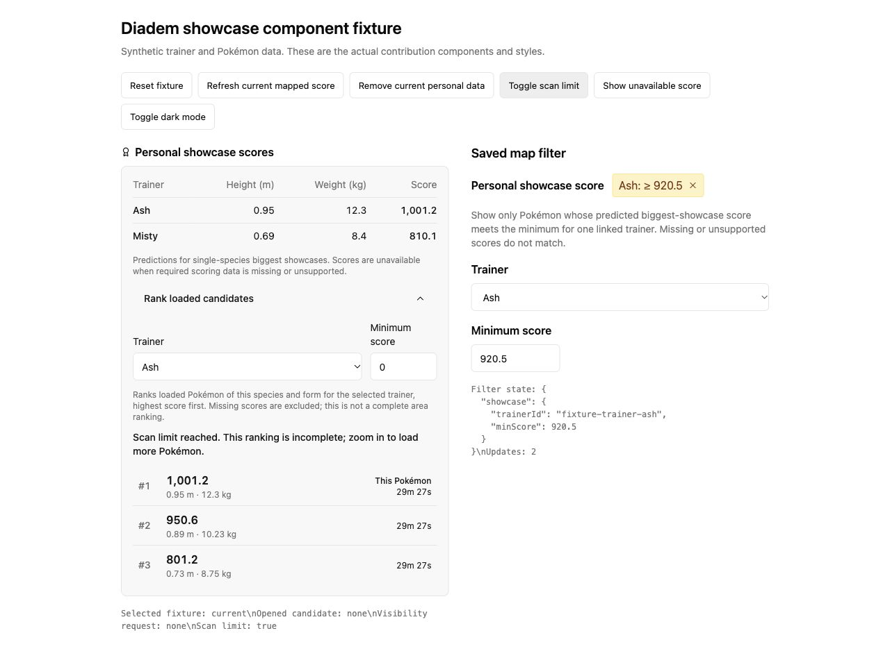
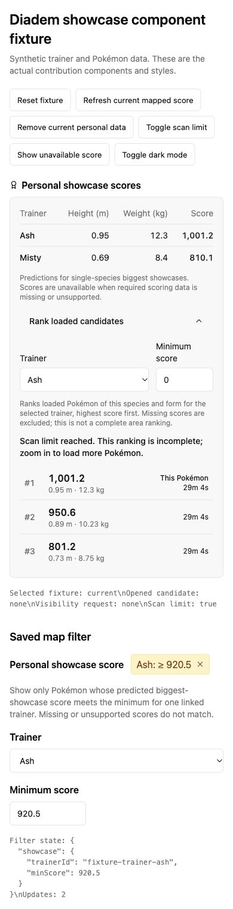

Diadem can show each linked trainer's predicted height, weight and showcase score
in a Pokémon popup. Expand **Rank loaded candidates** to select a trainer, set a
minimum score and compare loaded Pokémon of the same species and form.

These component previews use synthetic trainer and Pokémon data; they are not live
encounter or game-score validation.

## Requirements

- Linked trainers configured through `server.playerId` (Diadem #200).
- Golbat with per-player `size_for` annotations
  ([UnownHash/Golbat#424](https://github.com/UnownHash/Golbat/pull/424), branch
  [`sy1vi3/Golbat:personal-sizes`](https://github.com/sy1vi3/Golbat/tree/personal-sizes)).
  For gRPC, use `dbcb905` or later, which carries `size_for` in the protobuf response.
  #423 alone provides personal shiny/background annotations, not personal dimensions.
- Golbat's masterfile must include per-form `height`, `weight` and `size_settings`
  ([Masterfile-Generator#53](https://github.com/WatWowMap/Masterfile-Generator/pull/53)).
  Golbat #424 omits `size_for` when that exact-form metadata is unavailable or when
  derived encounter IVs do not match the scanned IVs, even if shiny annotations work.
- Both `pokemon_personal_shiny` and `pokemon_iv` permission at the Pokémon's location.
- Complete IVs, a known size category and supported species/form scoring metadata.

Scoring runs in Diadem. Golbat supplies predicted personal dimensions; scanner-account
height and weight are never substituted for another trainer's dimensions. Public API
responses use Diadem's linked-trainer references, not raw player IDs.

## Filters and ranking

Edit a Pokémon filterset and select **Showcase score**. Choose a linked trainer and
enter the inclusive minimum score. The filter is off by default and does not require
the Pokémon to be shiny. A candidate without a score for that trainer does not match,
even when the minimum is zero. Other enabled filtersets still match independently.

Ranking and filtering use full-precision scores; display rounding does not decide
matches or ordering. Ranking covers currently loaded, unexpired candidates of the
selected Pokémon's exact species/form. It is not a whole-area search or a contest
leaderboard. Existing scan limits still apply before Diadem scores returned Pokémon;
when a scan hits its limit, Diadem retains its zoom-in notice and the ranking warns
that coverage is incomplete. Narrow the view or species filters to load candidates.

Shared filters retain their trainer reference. Another user's trainer is not
automatically substituted: the recipient must select their own linked trainer.

## Formula and metadata

The biggest single-species formula is credited to
[FatalisticFeline's Showcase Points Calculator](https://docs.google.com/spreadsheets/d/1ZZwlZ2DOYeO0ouUgu-jXn3qmIf8jE4WTa3BhmtVupHc/edit):

`800H/(H₀K) + 150W/(W₀K + 4σW) + 50(IV sum)/45 + (XXL ? 7300/41 : 0)`.

`H`/`W` are personal dimensions. `H₀`/`W₀`, weight deviation `σW` and the maximum
height group `K` come from exact species/form metadata; `K = xxlUpperBound / H₀`.
Diadem does not assume a universal height group or weight deviation.

When linked trainers are configured, Diadem joins the public
[PokeMiners Game Master](https://github.com/PokeMiners/game_masters/blob/master/latest/latest.json)
to numeric form IDs from the existing
[Masterfile](https://github.com/WatWowMap/Masterfile-Generator). These public sources
refresh every 24 hours, with bounded downloads. Failed refreshes retain the last
successful metadata. A first-load failure leaves scores unavailable without stopping
the map or hiding valid personal dimensions. Only compact scoring metadata is retained;
trainer identities are never sent to either source.

Scores are predictions under the published model, not independently verified game
scores. Missing or conflicting exact-form metadata produces **Unavailable**, rather
than borrowing another form's values. Missing IVs or size categories also produce no
score. Pumpkaboo/Gourgeist, unresolved disguises and transformed specimens are excluded
from scoring. Type, mixed-species and buddy contests are outside this implementation;
exact game rounding and tie behavior are not asserted.
